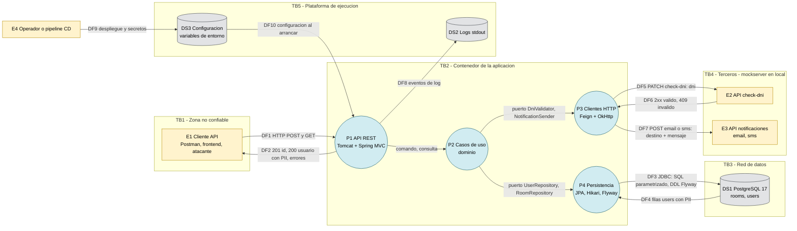

# Threat model - Users API (salas y usuarios)

**Contenido**

- [1. Alcance y supuestos](#1-alcance-y-supuestos)
- [2. Activos y clasificación de datos](#2-activos-y-clasificación-de-datos)
- [3. Diagrama de flujo de datos (DFD)](#3-diagrama-de-flujo-de-datos-dfd)
- [4. Aplicabilidad de STRIDE por tipo de elemento](#4-aplicabilidad-de-stride-por-tipo-de-elemento)
- [5. Tabla STRIDE por elemento](#5-tabla-stride-por-elemento)
- [6. Componentes con vulnerabilidades conocidas (2026-11-04)](#6-componentes-con-vulnerabilidades-conocidas-2026-11-04)
- [7. Observaciones fuera de alcance (cadena de suministro)](#7-observaciones-fuera-de-alcance-cadena-de-suministro)
- [8. Plan de mitigación priorizado](#8-plan-de-mitigación-priorizado)

| Campo          | Valor                                                                                          |
|----------------|------------------------------------------------------------------------------------------------|
| Sistema        | `code` - API REST de usuarios por sala (Spring Boot 3.2.12, Java 17, PostgreSQL 17)            |
| Versión        | rama `main`, commit `70a5846`                                                                  |
| Fecha          | 2026-11-04                                                                                     |
| Metodología    | Microsoft SDL: diagrama de flujo de datos (DFD) + **STRIDE por elemento**                       |
| Revisión       | En cada cambio de flujo de datos, frontera de confianza, dependencia externa o dato tratado    |

## 1. Alcance y supuestos

| ID | Supuesto / alcance                                                                                                                                                                      |
|----|-----------------------------------------------------------------------------------------------------------------------------------------------------------------------------------------|
| A1 | Se evalúa el despliegue descrito en `docker/docker-compose.yml` (perfil `app`) y, por extensión, un despliegue productivo en el que la API es accesible desde una red **no confiable**. |
| A2 | `mockserver` representa a **terceros reales** (verificación de DNI, email y SMS) que en producción estarían fuera de la organización.                                                     |
| A3 | El enunciado no pide autenticación ni autorización; aun así se analizan sus consecuencias (riesgos aceptados por el alcance del test, ver §8).                                         |
| A4 | Fuera de alcance: seguridad del host/orquestador, frontends y la cadena de suministro de CI (se dejan observaciones en §7).                                                             |

**Criterio de riesgo** (cualitativo, bajo el supuesto A1): `Riesgo = Probabilidad x Impacto` -> **Alto / Medio / Bajo**.

## 2. Activos y clasificación de datos

| Activo                                | Datos / ejemplo                                       | Clasificación                                      |
|---------------------------------------|-------------------------------------------------------|----------------------------------------------------|
| Datos personales del usuario          | `name`, `email`, `phone`, `dni`                       | **Confidencial - PII** (RGPD / LOPDGDD); el DNI es un identificador nacional |
| Rol del usuario                       | `admin`, `superadmin`                                 | Interno - determina privilegios de negocio         |
| Integridad del alta                   | Reglas: nombre <= 6, email válido y único, rol permitido, DNI aceptado por la API | Integridad alta                      |
| Credenciales                          | `DB_USERNAME`, `DB_PASSWORD`                          | Secreto                                            |
| Canales de notificación               | Envío de email / SMS (coste y reputación)             | Disponibilidad / coste                             |
| Disponibilidad del servicio           | `POST /rooms/{roomId}/users`, `GET /rooms/{roomId}/users/{userId}` | Disponibilidad                        |

## 3. Diagrama de flujo de datos (DFD)

> Bloque `mermaid` renderizado de forma nativa por la UI web de GitHub.
> Variante con el mismo contenido para Azure DevOps (`::: mermaid`, `[[_TOC_]]`): [threat-model.md](threat-model.md). Ambos ficheros deben mantenerse sincronizados.

**Leyenda**: rectángulo = entidad externa, círculo = proceso, cilindro = almacén de datos, subgrafo = frontera de confianza (TB). Todos los procesos escriben en DS2 y leen DS3; se dibuja un único flujo para no sobrecargar el diagrama. Los flujos P1-P2-P3-P4 son llamadas en el mismo proceso (JVM): no cruzan fronteras de confianza y no se analizan como flujos.

### 3.1 Elementos

| ID  | Elemento                     | Implementación                                                                                          |
|-----|------------------------------|---------------------------------------------------------------------------------------------------------|
| E1  | Cliente API                  | Cualquier llamante HTTP (Postman `postman/capgemini.postman_collection.json`, frontends, atacantes)     |
| E2  | API check-dni                | `PATCH {EXTERNAL_SERVICE_URL}/check-dni` (mockserver `init.json`: `99999999w` -> 409)                   |
| E3  | API de notificaciones        | `POST /email` (admin) y `POST /sms` (superadmin)                                                        |
| E4  | Operador / pipeline CD       | Despliega la imagen (`Dockerfile`) y define variables de entorno                                        |
| P1  | API REST                     | `UserController`, `GlobalExceptionHandler`, actuator (`health`, `info`), springdoc (`/swagger-ui.html`) |
| P2  | Casos de uso                 | `CreateUserService`, `GetUserService`, `UserNotificationService`, `User`, `Role`                        |
| P3  | Clientes HTTP                | `DniClient`, `NotificationClient`, `FeignDniValidator`, `Email/SmsNotificationSender`                   |
| P4  | Persistencia                 | `JpaUserRepositoryAdapter`, `JpaRoomRepositoryAdapter`, Hikari, Flyway (`V1__init.sql`, `V2__ids_as_bigint.sql`) |
| DS1 | PostgreSQL                   | Tablas `rooms`, `users` (UNIQUE `email`, `dni`, `phone`), volumen `postgres_data`                       |
| DS2 | Logs                         | Logback a stdout (recogidos por la plataforma)                                                          |
| DS3 | Configuración                | `application.yml` + `DB_URL`, `DB_USERNAME`, `DB_PASSWORD`, `DB_POOL_SIZE`, `EXTERNAL_SERVICE_URL`       |

### 3.2 Fronteras de confianza

| ID  | Frontera                            | Flujos que la cruzan |
|-----|-------------------------------------|----------------------|
| TB1 | Cliente no confiable -> aplicación  | DF1, DF2             |
| TB2 | Contenedor de la aplicación         | todos                |
| TB3 | Aplicación -> red de datos          | DF3, DF4             |
| TB4 | Aplicación -> terceros              | DF5, DF6, DF7        |
| TB5 | Aplicación -> plataforma            | DF8, DF9, DF10       |

## 4. Aplicabilidad de STRIDE por tipo de elemento

| Tipo de elemento | S | T | R | I | D | E |
|------------------|---|---|---|---|---|---|
| Entidad externa  | X |   | X |   |   |   |
| Proceso          | X | X | X | X | X | X |
| Almacén de datos |   | X | X (logs) | X | X |   |
| Flujo de datos   |   | X |   | X | X |   |

S = Spoofing (suplantación), T = Tampering (manipulación), R = Repudiation (repudio), I = Information disclosure (revelación de información), D = Denial of service (denegación de servicio), E = Elevation of privilege (elevación de privilegios).

## 5. Tabla STRIDE por elemento

### 5.1 Entidades externas

#### E1 - Cliente API

| ID   | STRIDE | Amenaza | Mitigación existente | Recomendación | Riesgo |
|------|--------|---------|----------------------|---------------|--------|
| E1.S | S | La API no autentica a nadie: cualquier llamante anónimo puede crear y consultar usuarios haciéndose pasar por un cliente legítimo. | Ninguna (fuera del alcance del enunciado, A3). | OAuth2/OIDC *resource server* (JWT) con *scopes* `users:write` / `users:read`, o API gateway con mTLS / API keys. | **Alto** |
| E1.R | R | Un cliente puede negar haber creado o consultado un usuario: no hay identidad del llamante ni registro de accesos. | Ninguna. | Identidad del llamante + log de auditoría (quién, qué, cuándo, id de correlación) + access log de Tomcat. | Medio |

#### E2 - API check-dni

| ID    | STRIDE | Amenaza | Mitigación existente | Recomendación | Riesgo |
|-------|--------|---------|----------------------|---------------|--------|
| E2.S  | S | Suplantación del verificador: la llamada es HTTP sin autenticación mutua; quien controle la red, el DNS o `EXTERNAL_SERVICE_URL` puede responder 2xx para cualquier DNI y colar altas con DNI no válido. | URL fija en configuración, no controlable por el cliente. *Fail-closed*: cualquier respuesta distinta de 2xx/409 o un *timeout* devuelve 503 y **no** se guarda el usuario (`FeignDniValidator`). | HTTPS con verificación de certificado + mTLS o API key; *allow-list* de salida (egress). | Medio |
| E2.S2 | S | El API de control de MockServer (`PUT /mockserver/expectation`, `/mockserver/retrieve`, `/mockserver/reset`) está expuesto en el puerto 1080 publicado en el host: cualquiera con acceso a la red puede reprogramar respuestas (p. ej. aceptar `99999999w`) o leer las peticiones recibidas (DNI, email, teléfono). | Solo afecta a entornos locales/compartidos con mockserver. | Publicar como `127.0.0.1:1080:1080` o no publicar el puerto (red interna de compose); nunca usar mockserver fuera de desarrollo. | Medio |
| E2.R  | R | No queda evidencia de la respuesta del verificador (solo se usa el código HTTP): no se puede demostrar por qué se aceptó un DNI. | Feign `logger-level: basic` registra método, URL y status. | Registrar en auditoría el resultado de la verificación (id de transacción del proveedor, fecha) sin el DNI en claro. | Bajo |

#### E3 - API de notificaciones

| ID   | STRIDE | Amenaza | Mitigación existente | Recomendación | Riesgo |
|------|--------|---------|----------------------|---------------|--------|
| E3.S | S | Suplantación del proveedor (HTTP sin autenticación): un intermediario recibe emails/teléfonos o confirma envíos que nunca se hicieron. | URL fija en configuración. | HTTPS + credenciales del proveedor (API key / OAuth2 *client credentials*) en un gestor de secretos. | Medio |
| E3.R | R | Un usuario o el proveedor pueden negar la notificación: un fallo solo se registra como `WARN` y se pierde (sin reintento ni identificador de mensaje). | Fallo registrado; el alta no se revierte (decisión documentada en `UserNotificationService`). | *Transactional outbox* con estado (`PENDING`/`SENT`/`FAILED`), reintentos con *backoff* e id de mensaje del proveedor. | Medio |

#### E4 - Operador / pipeline CD

| ID   | STRIDE | Amenaza | Mitigación existente | Recomendación | Riesgo |
|------|--------|---------|----------------------|---------------|--------|
| E4.S | S | Credenciales por defecto (`user` / `password`) en `application.yml` y `docker-compose.yml`: si no se sobrescriben, cualquiera con acceso a 5432 se autentica como la aplicación. | Las credenciales se pueden inyectar por variables de entorno. | Sin valores por defecto para secretos fuera del perfil local (*fail fast* al arrancar); gestor de secretos (Azure Key Vault, Kubernetes Secrets) y rotación. | **Alto** |
| E4.R | R | Cambios de configuración (p. ej. `EXTERNAL_SERVICE_URL`) sin trazabilidad. | Ninguna en el repositorio. | Configuración como código, despliegues solo vía pipeline con aprobación y auditoría del orquestador. | Bajo |

### 5.2 Procesos

#### P1 - API REST

| ID    | STRIDE | Amenaza | Mitigación existente | Recomendación | Riesgo |
|-------|--------|---------|----------------------|---------------|--------|
| P1.S  | S | Todos los endpoints (`POST`/`GET` de usuarios, `/swagger-ui.html`, `/v3/api-docs`, `/actuator/health`) aceptan peticiones anónimas. | Actuator limitado a `health,info`; detalles de health ocultos (valor por defecto `never`). | Ver E1.S. Restringir actuator y documentación a una red de gestión. | **Alto** |
| P1.T  | T | Manipulación del cuerpo de la petición (*mass assignment*: `id`, `roomId`...). | DTO `CreateUserRequest` (record) con solo 5 campos; `roomId` sale de la ruta, `id` lo genera la BD; validación de dominio en `User.create` (longitudes, formato de email, rol cerrado); JSON mal formado -> 400 genérico. | Opcional: rechazar propiedades desconocidas (`spring.jackson.deserialization.fail-on-unknown-properties=true`). | Bajo |
| P1.T2 | T | Vulnerabilidades conocidas en el contenedor web: Tomcat 10.1.33 (p. ej. CVE-2026-24880 *request smuggling* por *chunk extensions*, DoS en multipart) y Spring Framework 6.1.15; la línea Spring Boot 3.2 ya no tiene soporte OSS. | Ninguna (ver §6). | Actualizar a una línea soportada (Spring Boot 3.5.x + Spring Cloud 2025.0.x) y añadir SCA al CI (Dependabot / OWASP Dependency-Check). | **Alto** |
| P1.R  | R | Sin access log ni id de correlación: las respuestas 4xx no se registran y no se puede reconstruir quién consultó qué PII. | 5xx registrados por `GlobalExceptionHandler`. | `server.tomcat.accesslog.enabled=true`, trazas con Micrometer Tracing (traceId en MDC), auditoría de lecturas de PII. | Medio |
| P1.I  | I | **BOLA / IDOR** (OWASP API1:2023): `GET /rooms/1/users/{id}` devuelve email, teléfono y DNI completos a cualquiera, y los ids `BIGINT` son secuenciales, así que basta con recorrer `1..N`. | Solo se devuelve el usuario si pertenece a la sala indicada (`findByIdAndRoomId`). | Autorización por objeto; minimizar o enmascarar (`DNI ****678Z`, teléfono `*****0001`); id público no predecible (UUID); *rate limiting*. | **Alto** |
| P1.I2 | I | Oráculo de existencia: un `POST` con un email, DNI o teléfono ya registrado responde `409 error validation email/dni/phone`, lo que permite saber si una persona está dada de alta. | Requisito explícito del enunciado (409 + campo). | Autenticación + *rate limiting*; en producción, valorar un mensaje genérico o un alta asíncrona. | Medio |
| P1.I3 | I | Fugas en respuestas de error y en la documentación. | Mensajes genéricos (`malformed request`, `internal error`) sin *stack traces*. Matiz: el 503 revela el nombre de la dependencia (`external service unavailable: check-dni`) y Swagger UI está activo en todos los entornos. | Mensaje 503 genérico + código interno; `springdoc.api-docs.enabled=false` y `springdoc.swagger-ui.enabled=false` en el perfil productivo. | Bajo |
| P1.D  | D | Sin límite de peticiones. Cada `POST` hace hasta 2 llamadas HTTP síncronas (DNI y notificación, hasta ~2 s + 5 s cada una): pocas peticiones o un tercero degradado agotan los 200 hilos de Tomcat. | *Timeouts* Feign (`connect` 2 s, `read` 5 s); no se retiene la conexión de BD durante las llamadas externas (sin transacción envolvente); longitudes de campo acotadas. | *Rate limiting* (gateway o Bucket4j); *circuit breaker* + *bulkhead* (Resilience4j); notificación asíncrona (*outbox*); límite de tamaño del cuerpo en el gateway. | Medio |
| P1.E  | E | **Autoasignación de privilegios**: cualquier llamante anónimo puede crear usuarios con rol `superadmin` (OWASP API5:2023, *Broken Function Level Authorization*). | El rol solo admite `admin` o `superadmin` (`Role.fromValue`). | Solo un principal con permiso `users:admin` puede asignar `superadmin` (política en el caso de uso o `@PreAuthorize`). | **Alto** |
| P1.E2 | E | Ejecución de código por deserialización JSON (*gadgets* de Jackson). | Sin *default typing* ni `@JsonTypeInfo`; los DTO son records de `String`, así que los CVE de jackson-databind 2.15.4 no son explotables con este modelo (ver §6). | Mantener DTO planos; actualizar Jackson con la plataforma. | Bajo |

#### P2 - Casos de uso (dominio y aplicación)

| ID    | STRIDE | Amenaza | Mitigación existente | Recomendación | Riesgo |
|-------|--------|---------|----------------------|---------------|--------|
| P2.S  | S | Los casos de uso no conocen la identidad del llamante (`CreateUserCommand` no incluye ningún *principal*), así que no pueden aplicar autorización. | Ninguna. | Añadir el actor al comando y la política de autorización en la capa de aplicación (sin acoplarla a Spring). | Medio |
| P2.T  | T | Condición de carrera en la unicidad (comprobar y luego insertar el email). | Restricciones `UNIQUE` en `email`, `dni` y `phone`, traducidas a 409 (`JpaUserRepositoryAdapter`); invariantes garantizados por la fábrica `User.create`. | - | Bajo |
| P2.T2 | T | Normalización incompleta: el email se pasa a minúsculas, pero el DNI y el teléfono solo se recortan. `99999999w` y `99999999W` son valores distintos para la restricción `UNIQUE` (y para el mock), y el teléfono no se valida (cualquier texto de hasta 15 caracteres). | Longitud máxima y campo obligatorio. | Normalizar el DNI (mayúsculas, sin espacios ni guiones) y validar la letra de control (módulo 23) antes de llamar a la API; validar el teléfono en formato E.164. | Medio |
| P2.R  | R | No hay auditoría de negocio del alta (quién, cuándo, rol asignado): la tabla no tiene `created_at` ni `created_by`. | Ninguna. | Columnas de auditoría + evento de dominio `UserCreated` publicado en un log de auditoría. | Medio |
| P2.I  | I | Fuga de PII en logs desde el dominio. | `User.toString()` omite email, teléfono y DNI de forma intencionada; las excepciones de validación solo nombran el campo. | Mantenerlo (regla en la revisión de código). | Bajo |
| P2.D  | D | **Abuso de notificaciones / *SMS pumping***: cada alta envía un email o SMS a un destino elegido por el llamante. Rotando números o direcciones se generan spam y coste (fraude de tarificación). | `UNIQUE` en email y teléfono limita a un envío por destino; la validación de DNI añade fricción. | *Rate limiting* por cliente/IP, validación E.164 + *allow-list* de prefijos, verificación del destino (*double opt-in*), alertas de coste del proveedor. | **Alto** |
| P2.E  | E | Asignación de `superadmin` sin control de quién la otorga. | El rol es un valor cerrado del dominio. | Ver P1.E. | **Alto** |

#### P3 - Clientes HTTP (Feign + OkHttp)

| ID   | STRIDE | Amenaza | Mitigación existente | Recomendación | Riesgo |
|------|--------|---------|----------------------|---------------|--------|
| P3.S | S | No autentica al servidor (HTTP) ni se autentica ante él. | - | Ver E2.S y E3.S. | Medio |
| P3.T | T | Respuesta manipulada: el validador solo interpreta el código HTTP (2xx = válido, 409 = inválido), no el contenido. | *Fail-closed* ante errores o *timeouts* (503, el usuario no se guarda). | TLS; contrato de respuesta explícito (campo `valid`) y, si el proveedor lo ofrece, respuesta firmada. | Medio |
| P3.R | R | Trazabilidad de llamadas salientes. | Feign `BASIC`: método, URL, status y latencia, sin cuerpos (sin PII). | Propagar el id de correlación en cabeceras salientes (`traceparent`). | Bajo |
| P3.I | I | Se envían DNI, email y teléfono a terceros por HTTP en claro; las trazas de `FeignException` incluyen el cuerpo de la respuesta del tercero (contenido no confiable en logs). | Minimización: cada servicio recibe solo el dato que necesita (DNI a check-dni; email **o** teléfono a notificaciones) y el mensaje es fijo (`usuario guardado`). | TLS; contrato de encargado del tratamiento (art. 28 RGPD); registrar solo el status de los errores de terceros. | Medio |
| P3.D | D | Un tercero lento o caído retiene hilos de petición. | *Timeouts* 2 s / 5 s; la notificación fallida no rompe el alta. | *Circuit breaker* + *bulkhead* (Resilience4j); reintentos solo en operaciones idempotentes (`PATCH /check-dni`); notificación vía *outbox*. | Medio |
| P3.E | E | SSRF o redirección: usar la identidad de red del servidor contra destinos no previstos. | Host y rutas fijos en configuración: el cliente no controla la URL. | Desactivar el seguimiento de redirecciones en OkHttp/Feign; *allow-list* de egress. | Bajo |

#### P4 - Persistencia (JPA, Hikari, Flyway)

| ID   | STRIDE | Amenaza | Mitigación existente | Recomendación | Riesgo |
|------|--------|---------|----------------------|---------------|--------|
| P4.S | S | Suplantación de la base de datos: la conexión JDBC no usa TLS (`DB_URL` sin `sslmode`). Además, pgjdbc 42.6.2 es vulnerable a DoS con un servidor malicioso (CVE-2026-42198, SCRAM). | Credenciales por entorno. | `sslmode=verify-full` + CA de confianza; actualizar pgjdbc a 42.7.11 o superior. | Medio |
| P4.T | T | Inyección SQL. | Consultas derivadas de Spring Data JPA (parametrizadas); sin SQL nativo concatenado; migraciones Flyway solo desde el *classpath* y validadas por *checksum*. | - | Bajo |
| P4.R | R | Escrituras sin autor. | - | Ver P2.R. | Medio |
| P4.I | I | Los errores de integridad de PostgreSQL incluyen el valor duplicado (`Key (email)=(...) already exists`). Las violaciones conocidas se traducen sin registrarse, pero una no mapeada llega al manejador genérico, que la registra completa (PII en logs). | Traducción de `users_email_key`, `users_dni_key` y `users_phone_key` a 409. | No registrar el mensaje de `SQLException` en claro (sanitizar o registrar solo el SQLState y el nombre de la restricción). | Bajo |
| P4.D | D | Agotamiento del pool de conexiones. | Hikari `maximum-pool-size` configurable (10); las conexiones no se retienen durante las llamadas externas; índices `idx_users_room_id` y `UNIQUE(email)`. | `statement_timeout` en el rol de la BD; métricas del pool en actuator. | Bajo |
| P4.E | E | La misma cuenta ejecuta el DDL (Flyway) y el DML en tiempo de ejecución: si la aplicación se compromete, puede alterar o borrar el esquema. | - | Usuario de migración separado (`spring.flyway.user`) y usuario de ejecución con mínimo privilegio (`SELECT, INSERT` en `users`; `SELECT` en `rooms`). | Medio |

### 5.3 Almacenes de datos

#### DS1 - PostgreSQL

| ID    | STRIDE | Amenaza | Mitigación existente | Recomendación | Riesgo |
|-------|--------|---------|----------------------|---------------|--------|
| DS1.T | T | Acceso directo a la BD: el puerto 5432 se publica en el host con credenciales por defecto, lo que permite modificar datos (p. ej. promover a `superadmin`). | Restricciones `NOT NULL`/`UNIQUE`/FK. | No publicar el puerto (o publicarlo como `127.0.0.1:5432:5432`), red interna, credenciales robustas, `pg_hba.conf` restringido. | **Alto** |
| DS1.I | I | PII en claro en las tablas y en el volumen `postgres_data`; sin cifrado en reposo, sin política de retención ni endpoint de supresión (RGPD art. 5.1.e y 17). | - | Cifrado en reposo (servicio gestionado / disco), cifrado de columna o tokenización del DNI, política de retención y borrado, copias de seguridad cifradas. | Medio |
| DS1.D | D | Crecimiento ilimitado de `users` por altas anónimas masivas; caída de la BD. | `UNIQUE` evita duplicados; `restart: always`. | Ver P1.D (*rate limiting*); cuotas y alertas de almacenamiento. | Bajo |

#### DS2 - Logs

| ID    | STRIDE | Amenaza | Mitigación existente | Recomendación | Riesgo |
|-------|--------|---------|----------------------|---------------|--------|
| DS2.T | T | Inyección o falsificación de líneas de log. | Los valores del usuario no se escriben en logs (mensajes de validación constantes, `User.toString()` sin PII). Excepción: cuerpos de respuesta de terceros en trazas Feign. | Logs estructurados en JSON (escapan CR/LF) y envío a un SIEM inmutable. | Bajo |
| DS2.R | R | Logs no estructurados, sin id de correlación ni identidad: poco valor forense. | - | Logging estructurado + traceId + retención definida. | Medio |
| DS2.I | I | PII en logs. | `User.toString()` sin PII; Feign `BASIC` (sin cuerpos); `show-sql: false`. | Prohibir Feign `FULL` y `show-sql` en producción; ver P4.I. | Bajo |
| DS2.D | D | Volumen de logs: con un tercero caído, cada petición registra un 503 con *stack trace* completo (coste de ingesta y disco). | - | *Circuit breaker* (menos llamadas fallidas) y muestreo/limitación de logs repetidos. | Bajo |

#### DS3 - Configuración y secretos

| ID    | STRIDE | Amenaza | Mitigación existente | Recomendación | Riesgo |
|-------|--------|---------|----------------------|---------------|--------|
| DS3.T | T | Modificar `EXTERNAL_SERVICE_URL` o `DB_URL` desvía la PII a un atacante o anula la verificación del DNI (apuntando a un servicio que siempre responde 200). | Configuración externa al artefacto. | Control de acceso al orquestador, configuración versionada e inmutable, *allow-list* de egress. | Medio |
| DS3.I | I | Secretos en variables de entorno (visibles con `docker inspect` o en `/proc/<pid>/environ`) y valores por defecto versionados en `application.yml` y `docker-compose.yml`. | El endpoint actuator `env` no está expuesto. | Gestor de secretos o secretos montados como fichero; valores por defecto solo en un perfil `local`. | Medio |
| DS3.D | D | Configuración inválida impide el arranque. | Arranque *fail fast* (Flyway y datasource validan al iniciar); *probes* de liveness y readiness. | - | Bajo |

### 5.4 Flujos de datos que cruzan fronteras de confianza

| ID       | Flujo | STRIDE | Amenaza | Mitigación existente | Recomendación | Riesgo |
|----------|-------|--------|---------|----------------------|---------------|--------|
| DF1-2.T  | E1 <-> P1 | T | La API escucha en HTTP (8080) sin TLS: un intermediario puede alterar un alta (p. ej. cambiar el `rol`) o una respuesta. | - | TLS en ingress/gateway (TLS 1.2+, HSTS) o `server.ssl.*`. | **Alto** |
| DF1-2.I  | E1 <-> P1 | I | PII en claro en tránsito (cuerpo del `POST`, respuesta del `GET`). | - | TLS; minimización de la respuesta (ver P1.I). | **Alto** |
| DF1-2.D  | E1 <-> P1 | D | Cuerpos JSON sin límite explícito de tamaño. | Límites de Jackson (`StreamReadConstraints`) y longitudes de dominio. | Límite de tamaño de la petición en el gateway (p. ej. 16 KB). | Bajo |
| DF3-4.T  | P4 <-> DS1 | T | Manipulación de SQL o de resultados en la red de datos (sin TLS). | Red interna de compose. | `sslmode=verify-full`. | Medio |
| DF3-4.I  | P4 <-> DS1 | I | PII en claro en la red de datos. | La autenticación SCRAM-SHA-256 (por defecto en PostgreSQL 17) no envía la contraseña en claro. | TLS. | Medio |
| DF3-4.D  | P4 <-> DS1 | D | Latencia o caída de la BD. | `connectionTimeout` de Hikari (30 s); readiness probe. | Reducir `connectionTimeout`; `statement_timeout`. | Bajo |
| DF5-6.T  | P3 <-> E2 | T | Cambiar 409 por 200 (o el DNI enviado) en tránsito. | *Fail-closed* ante errores. | TLS + autenticación del servicio (E2.S). | Medio |
| DF5-6.I  | P3 <-> E2 | I | DNI en claro hacia el tercero. | Solo se envía el DNI. | TLS. | Medio |
| DF5-6.D  | P3 <-> E2 | D | Verificador no disponible: no se pueden dar altas. | 503 explícito; *timeouts*. | *Circuit breaker*; SLA con el proveedor. | Medio |
| DF7.T    | P3 -> E3 | T | Cambiar destino o mensaje (phishing en nombre del servicio). | Mensaje fijo `usuario guardado`. | TLS + autenticación del proveedor. | Medio |
| DF7.I    | P3 -> E3 | I | Email o teléfono en claro hacia el tercero. | Solo se envía el canal necesario según el rol. | TLS; contrato de encargado del tratamiento. | Medio |
| DF7.D    | P3 -> E3 | D | Notificaciones perdidas si el proveedor falla. | El alta no se ve afectada; el fallo se registra. | *Outbox* + reintentos (E3.R). | Medio |
| DF8      | P -> DS2 | T, I, D | Ver DS2. | - | - | - |
| DF9-10   | E4 -> DS3 -> P | T, I | Ver DS3 y E4. | - | - | - |

## 6. Componentes con vulnerabilidades conocidas (2026-11-04)

Resultado de cruzar las dependencias de ejecución (`mvn dependency:list`) con GitHub Advisory Database. La aplicabilidad se ha valorado según el uso real del componente en este servicio.

| Componente | Versión | CVE relevantes | Aplicabilidad en este servicio | Versión corregida |
|------------|---------|----------------|--------------------------------|-------------------|
| Spring Boot (parent) | 3.2.12 | CVE-2025-22235 | No aplica (requiere Spring Security con `EndpointRequest.to()`). **La línea 3.2.x no tiene soporte OSS**: deja de recibir parches de Tomcat y Spring. | Línea soportada (3.5.x) |
| tomcat-embed-core | 10.1.33 | 32 CVE; p. ej. CVE-2026-24880 (*request smuggling*), CVE-2025-48988 / CVE-2025-52520 / CVE-2025-61795 (DoS multipart), CVE-2026-41293 (cabeceras HTTP/2) | **Aplica parcialmente**: HTTP/1.1 *chunked* y multipart (Spring MVC procesa multipart por defecto). HTTP/2, AJP, WebDAV, autenticación DIGEST/FORM y *rewrite* no se usan. | 10.1.58+ |
| spring-web / spring-webmvc / spring-core | 6.1.15 | 16 CVE; p. ej. CVE-2026-41853 (*multipart smuggling*), CVE-2026-47884 (XsltView) | Mayoritariamente no aplica (sin recursos estáticos, vistas XSLT/JSP/script ni SSE); CVE-2026-41853 aplica. | 6.2.x más reciente / 7.0.x |
| jackson-databind | 2.15.4 | 12 CVE (tipado polimórfico, `InetAddress`, `Path`, `Duration`, `@JsonIdentityInfo`) | No aplica: DTO planos de `String`, sin *default typing*. | 2.18.11+ / 2.21.7+ |
| postgresql (pgjdbc) | 42.6.2 | CVE-2026-42198 (DoS SCRAM con servidor malicioso) | Aplica si la red de datos no es confiable (sin `verify-full`). | 42.7.11+ |
| logback-core | 1.4.14 | 6 CVE | No aplica (requieren escribir la configuración o usar SocketServer). | 1.5.34+ |
| commons-fileupload, commons-io, commons-lang3, bcprov-jdk18on, spring-security-crypto | 1.5 / 2.11.0 / 3.13.0 / 1.78 / 6.2.8 | CVE-2025-48976, CVE-2024-47554, CVE-2025-48924, varios BC, CVE-2025-22228 | Transitivas de Spring Cloud OpenFeign/Commons; funcionalidad no utilizada. | Se corrigen al actualizar el BOM |

**Acción**: actualizar la plataforma (Spring Boot 3.5.x + Spring Cloud 2025.0.x) en un cambio dedicado con la batería de tests completa, y añadir SCA (*software composition analysis*) al CI para detectar regresiones.

## 7. Observaciones fuera de alcance (cadena de suministro)

| Elemento | Observación | Recomendación |
|----------|-------------|---------------|
| GitHub Actions | Acciones referenciadas por *tag* mayor (`@v5`, `@v6`), no por SHA. | Fijar por SHA de commit (Dependabot las mantiene). `permissions: contents: read` ya aplica mínimo privilegio. |
| CI | Sin SAST ni SCA. | CodeQL, *dependency review*, OWASP Dependency-Check o Dependabot. |
| Imagen Docker | Imágenes base por *tag* (`eclipse-temurin:17-jre-alpine`), sin escaneo. El contenedor ya se ejecuta como **usuario no root** y con capas mínimas (JRE). | Fijar por *digest*, escanear con Trivy/Grype en el CI, sistema de ficheros de solo lectura en el despliegue. |

## 8. Plan de mitigación priorizado

| Prioridad | Medida | Amenazas cubiertas |
|-----------|--------|--------------------|
| 1 | Autenticación (OAuth2 *resource server*) + autorización por función y por objeto; solo un administrador asigna `superadmin`. | E1.S, P1.S, P1.I, P1.E, P2.S, P2.E |
| 2 | TLS en todos los flujos que cruzan fronteras (cliente, BD con `verify-full`, terceros) + autenticación de terceros. | DF1-2, DF3-4, DF5-6, DF7, E2.S, E3.S, P4.S |
| 3 | Actualizar a una plataforma soportada (Spring Boot 3.5.x) + SCA en CI. | P1.T2, §6 |
| 4 | *Rate limiting*, anti-abuso de notificaciones (E.164, *allow-list* de prefijos, alertas de coste) y resiliencia (Resilience4j, *outbox*). | P1.D, P2.D, P3.D, E3.R, DF7.D |
| 5 | Protección de PII: enmascarar en `GET`, ids públicos no predecibles, cifrado en reposo, retención y supresión. | P1.I, DS1.I |
| 6 | Secretos y mínimo privilegio: sin valores por defecto, gestor de secretos, usuario de BD de ejecución sin DDL, no publicar 5432/1080. | E4.S, DS1.T, DS3.I, P4.E, E2.S2 |
| 7 | Auditoría y observabilidad: access log, traceId, eventos de auditoría de altas y lecturas. | E1.R, P1.R, P2.R, DS2.R |
| 8 | Normalizar y validar el DNI (letra de control) y el teléfono localmente. | P2.T2 |

**Riesgos aceptados por el alcance del test** (A3): ausencia de autenticación/autorización (E1.S, P1.S, P1.E) y el oráculo de existencia del 409 con nombre de campo (P1.I2), exigido por el enunciado. Antes de cualquier despliegue fuera de un entorno local deben quedar mitigados al menos los puntos 1 a 3.

